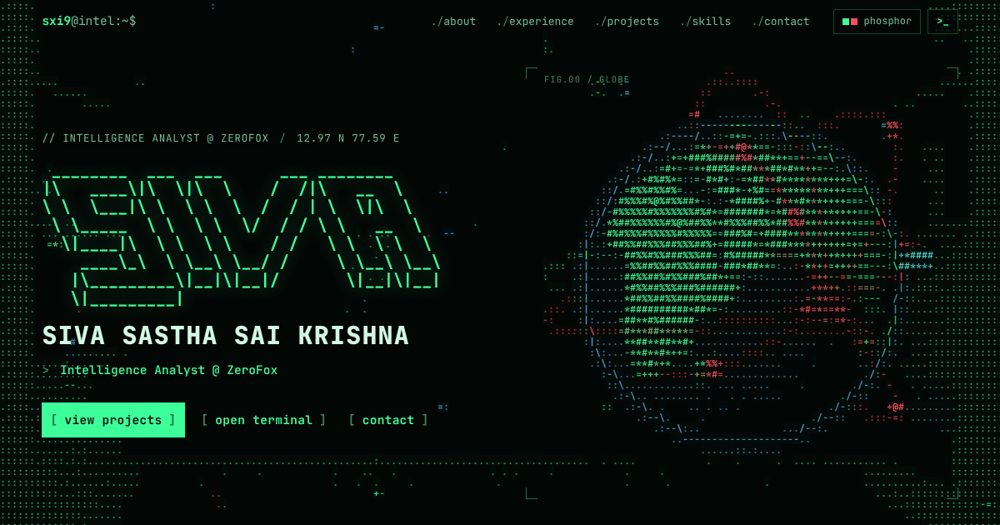

# sxi9 / portfolio

The portfolio of **Siva Sastha Sai Krishna** (`sxi9`), Intelligence Analyst.

Every scene on the page is real 3D geometry in [three.js](https://threejs.org), and every pixel of it is
drawn as text: a custom two-pass shader turns the render into a grid of characters, anchored to the
document so the glyphs scroll like the page they are printed on.



## Run it

```bash
npm install
```

```bash
npm run dev
```

Open http://127.0.0.1:5173. For a production build:

```bash
npm run build
```

```bash
npm run preview
```

The build lands in `dist/` and uses relative asset URLs, so it works at a domain root and under a
sub-path without configuration.

## Change the content

Everything the site says lives in **`src/content.js`**: profile, about, experience, the eight featured
projects, the archive, skills, certifications, the colour themes. Edit that file and the page, the
terminal and the prerendered HTML all follow.

| To do this | Edit |
| --- | --- |
| Change the intro, links or the rotating line | `profile` |
| Add a job | `experience` (newest first) |
| Add a featured project | `featured`: give it a `figure` from the list below |
| Add a smaller project | `archive` |
| Add or recolour a theme | `themes`: four colours each (`ink`, `hot`, `cool`, `bg`) |
| Replace the big name banner | `HERO_BANNER` (any figlet output works) |

Things worth checking, because they were carried over from older sources rather than confirmed:

- **Certifications** come from the previous portfolio (September 2025).
- **Contact email** is the one published on the previous portfolio. There is no phone number and no
  resume link on this site; add them to `profile.links` and `src/render.js` if you want them.
- **Education** is not on the page: add a section to `content.js` and `render.js` if you want one.
- `og:image` in `index.html` is a relative URL. Once the site has a home, make it absolute so link
  previews work everywhere.

## The figures

A featured project shows one of these models next to its card (`figure: 'onion'`, and so on).

| Name | What it is | Used for |
| --- | --- | --- |
| `globe` | Earth from a real land mask, arcs converging on Bengaluru | hero |
| `onion` | cut-away onion, scan ring, orbiting site status | LeakWatch |
| `board` | evidence cards tied with red thread | Cyber Investigation Board |
| `phone` | handset with a live log and outbound connections | Android Sentinel |
| `katana` | a katana over a scanned network | Samurai Scan |
| `arm` | desk arm sorting cubes with real inverse kinematics | SO-101 Workcell |
| `cluster` | laptops and phones passing a token around | home-cluster |
| `fleet` | endpoints sending heartbeats to a server | MSP |
| `rack` | a server rack with a unit sliding out for service | WHM |
| `dish` | an uplink dish sending rings | contact |

To add one, write `src/gl/figures/<name>.js` (copy a short one such as `dish.js`), register it in
`src/gl/figures/index.js`, and reference it from `content.js`. A figure is a three.js scene built
with the helpers in `figures/common.js`. Colour is semantic rather than literal: grey is the theme's
ink, red its hot accent, blue its cool accent, so a figure never needs to know which theme is active.

## The terminal

Press `` ` `` (or the `>_` button). `help` lists everything; a few highlights:

| Command | Does |
| --- | --- |
| `ls`, `ls -a` | featured projects, or all of them |
| `open leakwatch` | jump to a project (or open its link) |
| `cd projects` | scroll to a section |
| `theme amber` | `phosphor`, `amber`, `ice`, `ronin` |
| `charset measured` | swap the character ramp: `classic`, `measured`, `dense`, `binary`, `minimal` |
| `fetch` | a system summary, including the live character grid size |

## Deploy

**Vercel or Netlify.** Import the repository. Both detect Vite; the build command is `npm run build`
and the output directory is `dist`. No other settings.

**GitHub Pages.** A workflow is included at `.github/workflows/pages.yml`. In the repository go to
Settings, then Pages, set the source to "GitHub Actions", then run "Deploy to GitHub Pages" from the
Actions tab. To publish on every push, uncomment the `push` trigger in that file.

## How the rendering works

```
 3D scenes ──► small supersampled target ──► cells pass ──► glyph pass ──► canvas
 (shaft + figures)   (4 x 8 samples per cell)   (1 texel per character:   (atlas glyphs
                                                 ink colour + glyph index)  copied 1:1)
```

- **One canvas, document-anchored.** The canvas is the size of the viewport and follows the scroll
  position inside an absolutely positioned layer. The character grid is fixed to the document, not
  the viewport, so glyphs move exactly like real text and never shimmer while scrolling.
- **Figures draw into DOM rectangles.** Each `<div class="stage" data-figure="...">` is a window: the
  engine renders that figure's scene into the element's rectangle, so layout stays in CSS.
- **The cells pass** box-filters the supersampled block behind each character, maps brightness to a
  glyph from a ramp, picks the theme colour from the semantic channel, and draws silhouettes with
  `| / - \` wherever the depth buffer says a shape ends.
- **The glyph pass** copies atlas texels 1:1 in device pixels, which is why the characters are as
  sharp as the DOM text around them.
- **The ambient world** is an endless shaft the page descends through. Its far wall is tied 1:1 to
  the document; everything nearer slides past faster.

Text is prerendered: `vite.config.js` runs `src/render.js` at build time and writes the content into
`index.html`, so the page is readable before (and without) JavaScript. three.js loads as a separate
chunk while the boot sequence plays.

Fallbacks: no WebGL 2 gives a static backdrop and placeholders; `prefers-reduced-motion` freezes the
figures and skips the boot sequence and the typing effects; sustained slow frames lower the canvas
resolution automatically.

## Layout of the repository

```
index.html              shell; content is injected at build time
vite.config.js          the prerender plugin
src/content.js          every word on the site
src/render.js           content -> HTML (runs in Node and in the browser)
src/styles.css          the text layer
src/main.js             wiring
src/ui/                 boot sequence, nav and depth rail, terminal, themes, id card, tag cloud
src/gl/engine.js        the renderer described above
src/gl/shaders.js       cells pass and glyph pass
src/gl/atlas.js         glyph atlas and character ramps
src/gl/shaft.js         the ambient world
src/gl/figures/         one file per 3D model
scripts/                regenerates the globe's land mask
```

## Credits

[three.js](https://threejs.org) (MIT), [JetBrains Mono](https://www.jetbrains.com/lp/mono/) (OFL 1.1),
land mask derived from [Natural Earth](https://www.naturalearthdata.com) 110m data (public domain).
No analytics, no cookies, no third-party requests.
